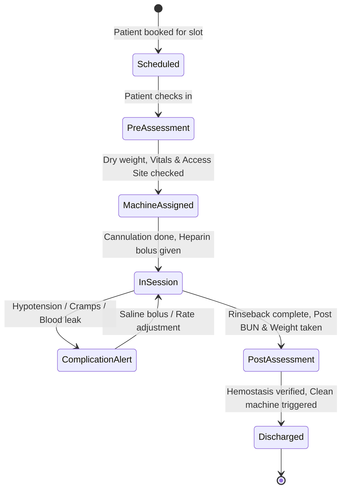

# 🏥 CLINICAL SPECIALTIES SPECIFICATION: DIALYSIS, ICU & OPERATION THEATRE
**Covers Modules #13 (ICU / Critical Care), #14 (Operation Theatre), and #19 (Dialysis Management)**

---

## 1. DIALYSIS MANAGEMENT SYSTEM (Module #19)

### 1.1 Clinical Logic & Problem Statement
Hemodialysis aur Peritoneal Dialysis patients ko periodic sessions (weekly 2-3 times) ki jarurat hoti hai. Isme dry weight versus pre-dialysis weight difference se ultrafiltration (UF) target set kiya jata hai, heparin dosing regulate hoti hai, aur reuse dialyzer bundles ka fiber bundle volume (FBV) track karna mandatory hota hai.

### 1.2 Mathematical & Clinical Formulas
1. **Ultrafiltration (UF) Goal**:
   $$\text{UF Goal (L)} = (\text{Pre-dialysis Weight} - \text{Dry Weight}) + \text{Saline Flush/Rinseback (approx 0.3L)} + \text{Oral Intake during Session}$$
2. **Urea Reduction Ratio (URR)**:
   $$\text{URR (\%)} = \frac{\text{Pre BUN} - \text{Post BUN}}{\text{Pre BUN}} \times 100$$
3. **Dialyzer Reuse Eligibility**:
   Fiber Bundle Volume (FBV) must be $\ge 80\%$ of baseline volume. Reuse count capped at 10-12 uses per infection control SOP.

### 1.3 State Machine & Session Flow


### 1.4 Frontend UI / UX & Micro-Animations
- **Framework**: React 18 / TypeScript + Tailwind CSS.
- **Component**: `DialysisStationMatrix.tsx`
- **Visual Design**:
  - Dark/Light slate theme with cyan neon accents for fluid status (`#06b6d4`).
  - Grid of Dialysis Bays: Card shows Dialyzer Model, Machine ID, Patient UHID, BFR (Blood Flow Rate), DFR (Dialysate Flow Rate), Transmembrane Pressure (TMP), and Real-time UF Rate gauge.
  - **Micro-Animations**: Framer Motion pulse animation (`animate={{ scale: [1, 1.03, 1] }}`) on active bays. Red flashing indicator if TMP exceeds 250 mmHg or MAP drops below 65 mmHg.
- **Libraries**:
  - `framer-motion`: Session status transit cards and drawer slide-overs.
  - `lucide-react`: Icons (`Activity`, `Droplets`, `AlertTriangle`, `HeartPulse`).
  - `recharts`: Live hourly blood pressure & ultrafiltration progress curve.

### 1.5 Database Schema (PostgreSQL)
```sql
CREATE TABLE dialysis_machines (
    id UUID PRIMARY KEY DEFAULT gen_random_uuid(),
    hospital_id UUID NOT NULL,
    machine_code VARCHAR(50) UNIQUE NOT NULL,
    brand VARCHAR(100), -- e.g. Fresenius 4008S, Nipro
    status VARCHAR(30) DEFAULT 'AVAILABLE', -- AVAILABLE, IN_USE, DISINFECTION, MAINTENANCE
    last_chemical_disinfection TIMESTAMP WITH TIME ZONE,
    total_hours_run NUMERIC(10,2) DEFAULT 0.0
);

CREATE TABLE dialysis_sessions (
    id UUID PRIMARY KEY DEFAULT gen_random_uuid(),
    uhid VARCHAR(50) NOT NULL,
    patient_id UUID NOT NULL,
    machine_id UUID REFERENCES dialysis_machines(id),
    session_date DATE NOT NULL,
    shift_slot VARCHAR(20), -- MORNING, AFTERNOON, EVENING, NIGHT
    vascular_access_type VARCHAR(50), -- AV_FISTULA, AV_GRAFT, JUGULAR_PERMCATH
    dry_weight_kg NUMERIC(5,2) NOT NULL,
    pre_weight_kg NUMERIC(5,2) NOT NULL,
    target_uf_liters NUMERIC(4,2) NOT NULL,
    dialyzer_model VARCHAR(100),
    dialyzer_reuse_number INT DEFAULT 1,
    heparin_bolus_units INT,
    heparin_maintenance_units_hr INT,
    post_weight_kg NUMERIC(5,2),
    achieved_uf_liters NUMERIC(4,2),
    pre_bun NUMERIC(6,2),
    post_bun NUMERIC(6,2),
    urr_percentage NUMERIC(5,2),
    complications JSONB, -- e.g. [{"time": "11:30", "event": "HYPOTENSION", "intervention": "100ml NS"}]
    status VARCHAR(30) DEFAULT 'SCHEDULED', -- PRE_ASSESSMENT, RUNNING, COMPLETED, CANCELLED
    created_at TIMESTAMP WITH TIME ZONE DEFAULT NOW()
);
```

---

## 2. ICU & CRITICAL CARE MANAGEMENT (Module #13)

### 2.1 Clinical Logic & Problem Statement
Intensive Care Units demand continuous high-acuity charting: invasive hemodynamic monitoring, ventilator parameter titrations, vasoactive infusion drips ($\mu\text{g/kg/min}$), and automated risk prediction scores (APACHE II, SOFA) to alert for septic shock and organ failure.

### 2.2 Mathematical Scores Engine
1. **Sequential Organ Failure Assessment (SOFA Score)** (Calculated every 24h):
   - **Respiration**: $\text{PaO}_2 / \text{FiO}_2$ ratio ($< 100$ with mechanical vent = 4 pts).
   - **Coagulation**: Platelets count ($< 20 \times 10^3/\mu\text{L}$ = 4 pts).
   - **Liver**: Bilirubin level ($> 12.0\text{ mg/dL}$ = 4 pts).
   - **Cardiovascular**: MAP & vasopressor requirement (Norepinephrine $> 0.1\mu\text{g/kg/min}$ = 4 pts).
   - **CNS**: Glasgow Coma Scale (GCS $< 6$ = 4 pts).
   - **Renal**: Creatinine level ($> 5.0\text{ mg/dL}$ or urine output $< 200\text{ mL/day}$ = 4 pts).
   *Score $\ge 2$ indicates acute organ dysfunction; alert triggered to Intensivist.*

### 2.3 Infusion Dosing Calculator Logic
$$\text{Infusion Rate (mL/hr)} = \frac{\text{Prescribed Dose } (\mu\text{g/kg/min}) \times \text{Weight (kg)} \times 60}{\text{Drug Concentration in Bag } (\mu\text{g/mL})}$$

### 2.4 Frontend UI / UX & Micro-Animations
- **Component**: `IcuIntensiveConsole.tsx`
- **Visual Design**:
  - High-contrast clinical dark cockpit (`#0f172a` slate background with lime/emerald telemetry waveforms `#10b981`).
  - Interactive Bed Grid: Bed 1 to Bed 20. Displays live Arterial Line waveform, CVP, SpO2, Heart Rate, EtCO2.
  - Quick-action modal for **"Code Blue Emergency"** that triggers siren audio, pushes alert to all hospital on-duty crash teams, and changes screen border to pulsing crimson `#ef4444`.
- **Micro-Animations**: Smooth cubic-bezier SVG waveforms using HTML5 Canvas or WebGL rendering 60 FPS sweep lines mimicking bedside monitors.

### 2.5 Database Schema (PostgreSQL)
```sql
CREATE TABLE icu_patient_flowsheet (
    id UUID PRIMARY KEY DEFAULT gen_random_uuid(),
    admission_id UUID NOT NULL,
    uhid VARCHAR(50) NOT NULL,
    recorded_at TIMESTAMP WITH TIME ZONE DEFAULT NOW(),
    nurse_id UUID NOT NULL,
    -- Hemodynamics
    heart_rate INT,
    invasive_sbp INT,
    invasive_dbp INT,
    mean_arterial_pressure INT,
    central_venous_pressure INT,
    spo2 NUMERIC(4,1),
    temperature_celsius NUMERIC(4,1),
    -- Ventilator parameters
    vent_mode VARCHAR(50), -- SIMV, PRVC, CPAP/PS, AC/VC
    fio2_percentage INT,
    peep_cmh2o INT,
    tidal_volume_ml INT,
    peak_inspiratory_pressure INT,
    -- Infusion Drugs running
    active_vasopressors JSONB, -- [{"drug": "Norepinephrine", "dose_mcg_kg_min": 0.15, "rate_ml_hr": 4.5}]
    -- Intake / Output
    hourly_urine_output_ml INT,
    iv_infusion_intake_ml INT,
    drain_output_ml INT,
    -- Scores
    gcs_score INT,
    sofa_score INT,
    apache2_score INT
);
```

---

## 3. OPERATION THEATRE (OT) & SURGICAL CHECKLIST (Module #14)

### 3.1 Clinical Logic & Problem Statement
Operation Theatres require meticulous coordination among surgeons, anesthetists, scrub nurses, perfusionists, and floor techs. A single misstep can be fatal. It enforces:
1. WHO Surgical Safety Checklist (Sign-In, Time-Out, Sign-Out).
2. Intra-operative Swab, Needle, and Instrument counts with strict hard-stop validation before wound closure.
3. Post-Anesthesia Care Unit (PACU) Aldrete score for recovery discharge.

### 3.2 WHO Surgical Safety Checklist Workflow
- **Sign In** (Before induction of anesthesia):
  - Confirm identity, site, procedure, and consent with patient.
  - Pulse oximeter active & audible?
  - Known allergy, difficult airway, aspiration risk checked?
  - Risk of $>500\text{ mL}$ blood loss (7mL/kg in children) and IV lines prepared?
- **Time Out** (Before skin incision):
  - Entire team introduces themselves by name and role.
  - Surgeon, anesthetist, and nurse verbally confirm patient name, procedure, and incision site.
  - Anticipated critical events, operative duration, anticipated blood loss reviewed.
  - Antibiotic prophylaxis given within last 60 minutes?
  - Essential imaging displayed?
- **Sign Out** (Before patient leaves operating room):
  - Nurse verbally confirms procedure recorded.
  - Instrument, sponge, and needle counts are **VERIFIED 100% CORRECT**.
  - Specimen labeled correctly with patient UHID.
  - Key recovery and post-op management concerns reviewed.

### 3.3 PACU Modified Aldrete Score (Recovery Discharge Criteria)
Criteria evaluated: Activity (voluntary movement), Respiration, Circulation (BP within 20% of pre-op), Consciousness, and O2 Saturation.
$$\text{Score } \ge 9/10 \implies \text{Safe to transfer from PACU to IPD Ward}$$

### 3.4 Frontend UI / UX & Micro-Animations
- **Component**: `OtMasterOrchestrator.tsx`
- **Visual Design**:
  - Gantt Chart Timeline View (Horizontal hours 00:00 to 24:00 across OT 1 to OT 8).
  - Drag-and-Drop scheduling with automatic turnover/cleaning gap buffer (minimum 30 minutes).
  - Interactive Step-by-Step WHO Checklist with biometric or digital PIN sign-off for Surgeon and Anesthetist.
  - **Sponge & Instrument Counter Widget**: Real-time counter tally with big tactile +/- buttons and green badge for "Balanced" or flashing amber warning for "Discrepancy".
- **Libraries**:
  - `@dnd-kit/core`: Frictionless drag-and-drop surgery slot scheduling.
  - `canvas-confetti`: Rewarding celebration micro-animation on 100% successful checklist sign-out.

### 3.5 Database Schema (PostgreSQL)
```sql
CREATE TABLE ot_rooms (
    id UUID PRIMARY KEY DEFAULT gen_random_uuid(),
    hospital_id UUID NOT NULL,
    room_number VARCHAR(50) NOT NULL,
    specialty_capability VARCHAR(100)[], -- ['CARDIOTHORACIC', 'NEURO', 'ORTHO', 'GENERAL']
    laminar_airflow_status BOOLEAN DEFAULT TRUE,
    hepa_filter_last_service DATE
);

CREATE TABLE ot_surgical_cases (
    id UUID PRIMARY KEY DEFAULT gen_random_uuid(),
    uhid VARCHAR(50) NOT NULL,
    patient_id UUID NOT NULL,
    ot_room_id UUID REFERENCES ot_rooms(id),
    primary_surgeon_id UUID NOT NULL,
    chief_anesthetist_id UUID NOT NULL,
    scrub_nurse_id UUID NOT NULL,
    procedure_name VARCHAR(255) NOT NULL,
    scheduled_start TIMESTAMP WITH TIME ZONE NOT NULL,
    scheduled_end TIMESTAMP WITH TIME ZONE NOT NULL,
    actual_incision_time TIMESTAMP WITH TIME ZONE,
    actual_closure_time TIMESTAMP WITH TIME ZONE,
    surgery_type VARCHAR(30) DEFAULT 'ELECTIVE', -- ELECTIVE, EMERGENCY
    who_sign_in JSONB, -- checklist answers + timestamps + signed_by
    who_time_out JSONB,
    who_sign_out JSONB,
    sponge_and_swab_count JSONB, -- {"initial": 20, "added": 10, "final_count": 30, "status": "VERIFIED_CORRECT"}
    implant_serial_numbers TEXT[],
    pacu_aldrete_score INT,
    status VARCHAR(50) DEFAULT 'SCHEDULED' -- SCHEDULED, PRE_OP, INTRA_OP, PACU, DISCHARGED_TO_WARD
);
```

---
*Created as part of the Findmedi Enterprise HMS Comprehensive Blueprint.*
