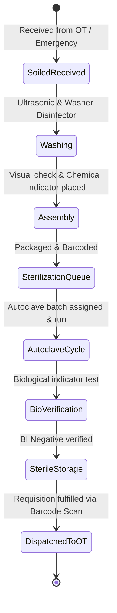
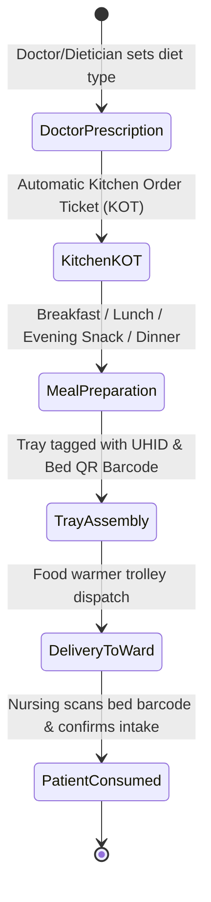

# 🏥 HOSPITAL SUPPORT SERVICES SPECIFICATION: CSSD, LAUNDRY & DIETETICS
**Covers Modules #37 (Laundry / Linen), #38 (Diet / Kitchen), and #39 (CSSD - Central Sterile Supply Department)**

---

## 1. CSSD (CENTRAL STERILE SUPPLY DEPARTMENT) (Module #39)

### 1.1 Clinical Logic & Operational Workflows
CSSD hospital ke infection control ka backbone hai. Koi bhi surgical instrument jo patient par use hota hai, uski life cycle 6 strict phases me follow hoti hai:
1. **Decontamination & Cleaning**: Enzymatic soak, ultrasonic cleaner, and automated washer-disinfector.
2. **Inspection & Tray Assembly**: Instrument integrity check (scissors sharpness, forceps alignment), packing in surgical wraps or rigid containers with Class 5/6 chemical indicators.
3. **Sterilization Cycle**: Steam Autoclave ($134^\circ\text{C}$ at 2.1 bar for 4 mins or $121^\circ\text{C}$ for 15 mins) / Ethylene Oxide (EtO) / Plasma Sterilizer.
4. **Biological Indicator (BI) Incubation**: Geobacillus stearothermophilus spores incubated for 1-4 hours to confirm 100% lethality.
5. **Sterile Storage**: Temperature ($18-22^\circ\text{C}$) and positive air pressure controlled zone.
6. **Dispatch & Expiry Tracking**: Trays expire after 30 to 90 days depending on double-wrap vs rigid container. If expired, tray is recalled and re-sterilized.

### 1.2 State Machine


### 1.3 Frontend UI / UX & Micro-Animations
- **Component**: `CssdSterileCommander.tsx`
- **Visual Design**:
  - Industrial clean aesthetic (Teal/Emerald `#0d9488` with crisp sterile white and slate backgrounds).
  - Autoclave Batch Monitor Card: Visual animated temperature ($^\circ\text{C}$) gauge and chamber pressure (bar) meter.
  - Interactive Tray Scanner: Supports USB or Bluetooth 2D barcode gun. Sound effects on scan (gentle chime for valid, double beep for expired or unverified batch).
- **Micro-Animations**:
  - Circular SVG progress meter indicating countdown time remaining in active sterilization cycle.

### 1.4 Database Schema (PostgreSQL)
```sql
CREATE TABLE cssd_trays_master (
    id UUID PRIMARY KEY DEFAULT gen_random_uuid(),
    hospital_id UUID NOT NULL,
    tray_code VARCHAR(50) UNIQUE NOT NULL, -- e.g. TRAY-ORTHO-MAJOR-01
    tray_name VARCHAR(150) NOT NULL,
    specialty VARCHAR(50) NOT NULL,
    total_instruments_count INT NOT NULL,
    item_checklist JSONB NOT NULL, -- [{"item": "Mayo Scissor Curve", "qty": 2}, {"item": "BP Handle #4", "qty": 1}]
    packaging_type VARCHAR(50) NOT NULL -- RIGID_CONTAINER, DOUBLE_SMS_WRAP, PAPER_PLASTIC_POUCH
);

CREATE TABLE cssd_sterilization_batches (
    id UUID PRIMARY KEY DEFAULT gen_random_uuid(),
    autoclave_machine_id VARCHAR(50) NOT NULL,
    cycle_number INT NOT NULL,
    sterilizer_type VARCHAR(30) NOT NULL, -- STEAM_134C, STEAM_121C, ETO, HYDROGEN_PEROXIDE_PLASMA
    start_time TIMESTAMP WITH TIME ZONE NOT NULL,
    end_time TIMESTAMP WITH TIME ZONE,
    peak_temp_celsius NUMERIC(5,2),
    peak_pressure_bar NUMERIC(4,2),
    biological_indicator_lot VARCHAR(50),
    biological_indicator_result VARCHAR(30) DEFAULT 'PENDING', -- PENDING, NEGATIVE (PASSED), POSITIVE (FAILED)
    operator_technician_id UUID NOT NULL,
    verified_by_supervisor_id UUID,
    status VARCHAR(30) DEFAULT 'IN_PROGRESS' -- IN_PROGRESS, COMPLETED_PASSED, FAILED_RECALLED
);

CREATE TABLE cssd_tray_instances (
    id UUID PRIMARY KEY DEFAULT gen_random_uuid(),
    tray_master_id UUID REFERENCES cssd_trays_master(id),
    serial_barcode VARCHAR(100) UNIQUE NOT NULL,
    batch_id UUID REFERENCES cssd_sterilization_batches(id),
    sterilized_at TIMESTAMP WITH TIME ZONE,
    expiry_date TIMESTAMP WITH TIME ZONE,
    current_location VARCHAR(50) DEFAULT 'STERILE_STORE', -- SOILED_ROOM, WASHER, PACKING, STERILE_STORE, OT_1, OT_2
    is_compromised BOOLEAN DEFAULT FALSE
);
```

---

## 2. LAUNDRY & LINEN CIRCULATION (Module #37)

### 2.1 Operational Logic & Infection Standards
Hospital linen (bed sheets, patient gowns, doctor scrubs, blankets, OT drapes) requires clean-soiled separation to prevent cross-contamination:
1. **Linen Classification**:
   - **White General Linen**: Standard ward sheets, pillow covers.
   - **Green/Blue OT Linen**: Lint-free, moisture repellent, autoclaved prior to surgery.
   - **Infected/Isolation Linen**: Double-bagged in water-soluble alginate bags and disinfected with sodium hypochlorite (1000 ppm chlorine solution) at $71^\circ\text{C}$ for minimum 25 minutes.
2. **Circulation Par Level Formula**:
   $$\text{Required Ward Par Level} = \text{Total Beds in Ward} \times 3$$
   *(1 set on bed + 1 set clean in ward cupboard + 1 set in laundry wash cycle).*
3. **Condemnation / Rejection Ratio**:
   Linen washed $> 50-70\text{ times}$ undergoes tearing inspection. Worn linen is condemned and replaced with fresh stock.

### 2.2 Database Schema (PostgreSQL)
```sql
CREATE TABLE linen_items_master (
    id UUID PRIMARY KEY DEFAULT gen_random_uuid(),
    hospital_id UUID NOT NULL,
    item_type VARCHAR(100) NOT NULL, -- BED_SHEET, PATIENT_GOWN, DOCTOR_SCRUB, PILLOW_COVER, OT_DRAPE
    color_code VARCHAR(30),
    expected_wash_lifespan INT DEFAULT 60
);

CREATE TABLE linen_ward_allocations (
    id UUID PRIMARY KEY DEFAULT gen_random_uuid(),
    ward_id UUID NOT NULL,
    item_master_id UUID REFERENCES linen_items_master(id),
    par_level_required INT NOT NULL,
    current_clean_stock INT NOT NULL,
    soiled_in_laundry INT NOT NULL,
    last_replenished_at TIMESTAMP WITH TIME ZONE DEFAULT NOW()
);

CREATE TABLE laundry_cycles (
    id UUID PRIMARY KEY DEFAULT gen_random_uuid(),
    cycle_batch_number VARCHAR(50) UNIQUE NOT NULL,
    wash_category VARCHAR(50) NOT NULL, -- GENERAL_CLEAN, INFECTED_ISOLATION, OT_STERILE_PREP
    wash_temperature_celsius INT DEFAULT 71,
    chemical_disinfectant_used VARCHAR(100),
    total_weight_kg NUMERIC(6,2),
    items_breakdown JSONB, -- [{"item_type": "BED_SHEET", "qty": 120}, {"item_type": "GOWN", "qty": 80}]
    status VARCHAR(30) DEFAULT 'WASHING' -- WASHING, DRYING, IRONING_FOLDING, READY_FOR_DISPATCH, DISPATCHED
);
```

---

## 3. DIETETICS, NUTRITION & KITCHEN OPERATIONS (Module #38)

### 3.1 Clinical Logic & Calculation Engine
Inpatients require customized medical nutrition therapy tailored to their diagnoses (Diabetes, Hypertension, Chronic Kidney Disease, Post-Op Gastrointestinal):
1. **Basal Energy Expenditure (BEE) - Harris-Benedict Formula**:
   - **For Men**:
     $$\text{BEE (kcal/day)} = 66.5 + (13.75 \times \text{Weight in kg}) + (5.003 \times \text{Height in cm}) - (6.75 \times \text{Age in yrs})$$
   - **For Women**:
     $$\text{BEE (kcal/day)} = 655.1 + (9.563 \times \text{Weight in kg}) + (1.850 \times \text{Height in cm}) - (4.676 \times \text{Age in yrs})$$
   - **Total Daily Energy Requirement**:
     $$\text{TDEE} = \text{BEE} \times \text{Activity Factor (1.2 for bedridden)} \times \text{Stress Factor (1.2 to 1.5 for sepsis/surgery)}$$

2. **Diet Categories & Rules**:
   - **Diabetic Diet**: Strict carbohydrate capping ($50\%$), high fiber, zero refined sugars.
   - **Renal Diet (Pre-Dialysis)**: Low protein ($0.6-0.8\text{ g/kg/day}$), low potassium ($< 2000\text{ mg}$), low sodium ($< 2000\text{ mg}$), fluid restricted ($500\text{ mL} + \text{Urine Output}$).
   - **NPO (Nil Per Os)**: Absolute food/water restriction prior to scheduled surgery. System must flag automated warning if kitchen attempts to generate a tray.
   - **Enteral/Tube Feeding**: RT feed formula prepared every 4 hours under laminar hood.

### 3.2 State Machine


### 3.3 Database Schema (PostgreSQL)
```sql
CREATE TABLE patient_diet_orders (
    id UUID PRIMARY KEY DEFAULT gen_random_uuid(),
    uhid VARCHAR(50) NOT NULL,
    admission_id UUID NOT NULL,
    bed_id UUID NOT NULL,
    prescribed_by_doctor_id UUID NOT NULL,
    diet_category VARCHAR(50) NOT NULL, -- REGULAR, SOFT, DIABETIC_LOW_SALT, RENAL_PROTEIN_RESTRICTED, LIQUID_RT_FEED, NPO
    caloric_target_kcal INT,
    protein_target_grams INT,
    fluid_restriction_ml INT,
    allergies TEXT[], -- ['NUTS', 'LACTOSE', 'GLUTEN']
    special_instructions TEXT,
    is_active BOOLEAN DEFAULT TRUE,
    created_at TIMESTAMP WITH TIME ZONE DEFAULT NOW()
);

CREATE TABLE kitchen_meal_dispatches (
    id UUID PRIMARY KEY DEFAULT gen_random_uuid(),
    diet_order_id UUID REFERENCES patient_diet_orders(id),
    meal_slot VARCHAR(30) NOT NULL, -- BREAKFAST, MID_MORNING, LUNCH, EVENING_TEA, DINNER
    scheduled_delivery_time TIME NOT NULL,
    tray_barcode VARCHAR(100) UNIQUE NOT NULL,
    prepared_by_chef_id UUID,
    delivered_by_staff_id UUID,
    status VARCHAR(30) DEFAULT 'KOT_GENERATED', -- KOT_GENERATED, COOKED, IN_TRANSIT, DELIVERED, CONSUMED, REJECTED
    nursing_intake_percentage INT -- 0%, 25%, 50%, 75%, 100%
);
```

---
*Created as part of the Findmedi Enterprise HMS Comprehensive Blueprint.*
