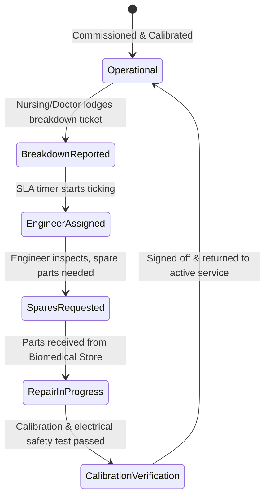

# 🏥 BIOMEDICAL ENGINEERING, FACILITY MGMT & ASSETS SPECIFICATION
**Covers Modules #40 (Biomedical Engineering), #41 (Facility & Medical Gas Plant), and #95 (Hospital Asset Management)**

---

## 1. BIOMEDICAL ENGINEERING & WORK ORDERS (Module #40)

### 1.1 Technical Logic & Regulatory Standards (AERB & NABH)
Hospital diagnostic and life-support machinery (Ventilators, Defibrillators, CT Scanners, Infusion Pumps, Dialysis units, C-Arm) require strict uptime, calibration certification, and risk category tracking.
1. **Equipment Criticality Classification**:
   - **Critical (Life Support - Category A)**: Ventilators, Defibrillators, Heart-Lung Machines, Anesthesia Workstations. *(Zero tolerance downtime; 15-minute response SLA).*
   - **Major (Diagnostic / Intervention - Category B)**: CT, MRI, Ultrasound, Cath Lab, Dialysis machines. *(2-hour response SLA).*
   - **Minor (Monitoring / General - Category C)**: ECG machines, BP monitors, Suction units, Patient stretchers. *(6-hour response SLA).*
2. **Preventive Maintenance (PPM) & Electrical Safety Testing (EST)**:
   - Run according to IEC 60601 / IEC 62353 safety standards (Chassis leakage current $< 100\mu\text{A}$, earth continuity $< 0.2\Omega$).
   - Automated 30-day advance alerts for PPM due dates.
3. **Uptime & Downtime Calculation**:
   $$\text{Equipment Availability / Uptime (\%)} = \frac{\text{Total Operating Hours in Month} - \text{Breakdown Hours}}{\text{Total Operating Hours in Month}} \times 100$$
   *(Target: $> 98.5\%$ for critical medical assets).*

### 1.2 State Machine


### 1.3 Database Schema (PostgreSQL)
```sql
CREATE TABLE biomedical_equipment_master (
    id UUID PRIMARY KEY DEFAULT gen_random_uuid(),
    hospital_id UUID NOT NULL,
    asset_tag VARCHAR(50) UNIQUE NOT NULL, -- e.g. BIO-VENT-ICU-04
    equipment_name VARCHAR(150) NOT NULL,
    manufacturer VARCHAR(100) NOT NULL,
    model_number VARCHAR(100),
    serial_number VARCHAR(100) UNIQUE NOT NULL,
    criticality_category VARCHAR(10) DEFAULT 'B', -- A, B, C
    department_location_id UUID NOT NULL,
    date_of_installation DATE NOT NULL,
    purchase_cost NUMERIC(12,2) NOT NULL,
    warranty_expiry_date DATE,
    contract_type VARCHAR(20) DEFAULT 'WARRANTY', -- WARRANTY, AMC, CMC, IN_HOUSE
    contract_vendor_name VARCHAR(150),
    contract_expiry_date DATE,
    ppm_frequency_months INT DEFAULT 3, -- e.g. quarterly
    last_ppm_date DATE,
    next_ppm_due_date DATE NOT NULL,
    status VARCHAR(30) DEFAULT 'OPERATIONAL' -- OPERATIONAL, BREAKDOWN, UNDER_MAINTENANCE, CONDEMNED
);

CREATE TABLE biomedical_work_orders (
    id UUID PRIMARY KEY DEFAULT gen_random_uuid(),
    equipment_id UUID REFERENCES biomedical_equipment_master(id),
    ticket_type VARCHAR(30) NOT NULL, -- BREAKDOWN, PPM, CALIBRATION_RENEWAL
    reported_by_staff_id UUID NOT NULL,
    reported_at TIMESTAMP WITH TIME ZONE DEFAULT NOW(),
    symptom_description TEXT NOT NULL,
    assigned_biomedical_engineer_id UUID,
    engineer_response_at TIMESTAMP WITH TIME ZONE,
    root_cause_analysis TEXT,
    spares_consumed JSONB, -- [{"part_number": "O2_CELL_01", "cost": 4500, "qty": 1}]
    rectified_at TIMESTAMP WITH TIME ZONE,
    downtime_hours NUMERIC(6,2),
    electrical_safety_test_passed BOOLEAN,
    status VARCHAR(30) DEFAULT 'REPORTED' -- REPORTED, IN_PROGRESS, AWAITING_PARTS, CLOSED
);
```

---

## 2. FACILITY MANAGEMENT & MEDICAL GAS PIPELINE SYSTEM (MGPS) (Module #41)

### 2.1 Critical Engineering Workflows & Alarms
Hospital facilities cannot suffer utility dropouts. The Medical Gas Pipeline System (Oxygen, Nitrous Oxide, Medical Air, Vacuum) is monitored continuously:
1. **Oxygen Plant / Liquid Medical Oxygen (LMO) Tank**:
   - Monitored variables: Level (mm of H2O), Pressure in pipeline ($4.2 \pm 0.2\text{ bar}$ or $60\text{ psi}$).
   - Low pressure alert trigger: When pipeline pressure drops below $3.8\text{ bar}$, automated solenoid valve switches over to primary emergency cylinder manifold bank, and high-priority siren pushes via WebSocket to Central Control Room.
2. **Medical Air & Surgical Vacuum**:
   - Vacuum target: $-400\text{ to } -600\text{ mmHg}$.
   - Medical Air ($4\text{ bar}$ for ventilators; $7\text{ bar}$ for surgical pneumatic tools).
3. **HVAC & Positive / Negative Pressure Rooms**:
   - **Isolation Rooms (Infection)**: Negative pressure relative to corridor ($-2.5\text{ Pa}$), minimum 12 Air Changes per Hour (ACH) with exhaust through HEPA filtration.
   - **Operation Theatres & Burn Units**: Positive pressure ($+15\text{ Pa}$), laminar unidirectional airflow, temperature $20-22^\circ\text{C}$, relative humidity $50-60\%$.

### 2.2 Database Schema (PostgreSQL)
```sql
CREATE TABLE facility_mgps_telemetry (
    id UUID PRIMARY KEY DEFAULT gen_random_uuid(),
    hospital_id UUID NOT NULL,
    recorded_at TIMESTAMP WITH TIME ZONE DEFAULT NOW(),
    lmo_tank_level_percentage NUMERIC(5,2),
    lmo_tank_pressure_bar NUMERIC(4,2),
    manifold_oxygen_pressure_bar NUMERIC(4,2),
    medical_air_4bar_pressure NUMERIC(4,2),
    surgical_air_7bar_pressure NUMERIC(4,2),
    vacuum_pressure_mmhg INT,
    nitrous_oxide_pressure_bar NUMERIC(4,2),
    is_alarm_active BOOLEAN DEFAULT FALSE,
    active_alarms JSONB -- e.g. [{"zone": "ICU-ZONE-A", "issue": "LOW_O2_PRESSURE", "val": 3.6}]
);

CREATE TABLE facility_hvac_zones (
    id UUID PRIMARY KEY DEFAULT gen_random_uuid(),
    zone_name VARCHAR(100) NOT NULL, -- e.g. OT-01-LAMINAR, ISOLATION-WARD-A
    required_pressure_type VARCHAR(20) NOT NULL, -- POSITIVE, NEGATIVE
    measured_differential_pa NUMERIC(5,2),
    temperature_celsius NUMERIC(4,1),
    relative_humidity_percentage INT,
    air_changes_per_hour INT,
    hepa_differential_pressure_pa INT,
    last_air_quality_particle_count_date DATE
);
```

---

## 3. FIXED ASSET MANAGEMENT & DEPRECIATION ENGINE (Module #95)

### 3.1 Accounting Logic & Depreciation Models
Hospital assets (MRI scanners, hospital beds, generators, autoclaves, computers) must be audited and amortized per Indian Accounting Standard (Ind AS 16) / Companies Act schedule:
1. **Straight-Line Depreciation (SLM)**:
   $$\text{Annual Depreciation Expense} = \frac{\text{Asset Purchase Cost} - \text{Salvage Residual Value}}{\text{Useful Life in Years}}$$
2. **Written Down Value (WDV / Declining Balance)**:
   $$\text{Depreciation Amount} = \text{Book Value at Start of Year} \times \left(1 - \sqrt[n]{\frac{\text{Salvage Value}}{\text{Cost}}}\right)$$
3. **QR / RFID Asset Tracking**:
   Physical stock audits verify presence in assigned wards via handheld RFID sweeps. Discrepancies generate auto-reconciliation tasks.

### 3.2 Database Schema (PostgreSQL)
```sql
CREATE TABLE hospital_fixed_assets (
    id UUID PRIMARY KEY DEFAULT gen_random_uuid(),
    hospital_id UUID NOT NULL,
    asset_code VARCHAR(50) UNIQUE NOT NULL, -- e.g. AST-FUR-BED-ICU-089
    description VARCHAR(255) NOT NULL,
    asset_class VARCHAR(50) NOT NULL, -- MEDICAL_EQUIPMENT, FURNITURE_FIXTURE, IT_HARDWARE, ELECTRICAL_PLANT
    date_of_capitalization DATE NOT NULL,
    original_purchase_cost NUMERIC(14,2) NOT NULL,
    depreciation_method VARCHAR(20) DEFAULT 'SLM', -- SLM, WDV
    useful_life_years INT NOT NULL,
    salvage_value NUMERIC(12,2) DEFAULT 0.00,
    accumulated_depreciation NUMERIC(14,2) DEFAULT 0.00,
    current_net_book_value NUMERIC(14,2) NOT NULL,
    physical_rfid_tag VARCHAR(100),
    assigned_building VARCHAR(50),
    assigned_floor VARCHAR(50),
    assigned_room VARCHAR(50),
    custodian_employee_id UUID,
    status VARCHAR(30) DEFAULT 'ACTIVE' -- ACTIVE, DISPOSED, UNDER_SCRAP_VALUATION
);
```

---
*Created as part of the Findmedi Enterprise HMS Comprehensive Blueprint.*
