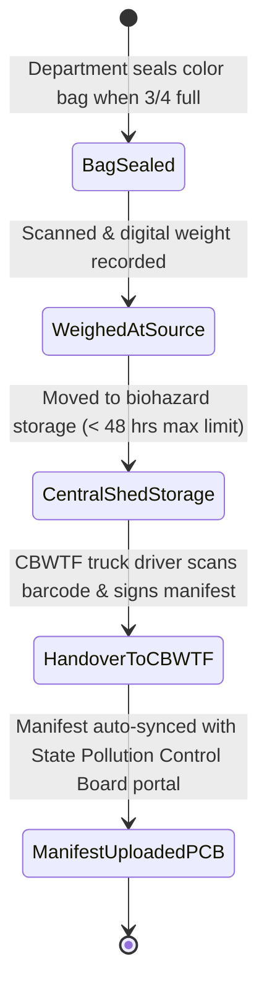

# 🏥 SAFETY, SECURITY, PARKING & BIOMEDICAL WASTE SPECIFICATION
**Covers Modules #91 (Biomedical Waste - BMW), #92 (Hospital Security), #93 (Parking Management), and #94 (Attendant Management)**

---

## 1. BIOMEDICAL WASTE (BMW) MANAGEMENT (Module #91)

### 1.1 Regulatory Compliance & Barcode Tracking (CPCB / State PCB)
Hospital biomedical waste management strictly adheres to the Bio-Medical Waste Management Rules (2016, amended 2018/2019) with mandatory GPS vehicle and barcoded color bag tracking:
1. **Color Coding & Waste Streams**:
   - **Yellow Bag (Incineration / Deep Burial)**: Human anatomical waste, animal waste, soiled cotton/gauze with body fluids, expired medicines, chemical waste.
   - **Red Bag (Autoclaving & Shredding / Recycling)**: Contaminated recyclable plastics (IV tubing, catheters, urine bags, syringes without needles, gloves).
   - **White Translucent Puncture-Proof Container (Sharp Pit / Encapsulation)**: Needles, scalpels, blades, contaminated sharp metal items.
   - **Blue Cardboard Box / Puncture-Proof Container (Disinfection & Recycling)**: Glassware, medicine ampoules, metallic orthopedic implants.
2. **CPCB Barcode Workflow**:
   - Every bag is pre-printed with a unique CPCB-compliant Barcode/QR code linked to the generating hospital unit, department, and time.
   - **Weighing Scale Integration**: Floor housekeeping staff weigh each bag on a calibrated digital Bluetooth/RS232 scale before handoff to central BMW holding shed.
   - **Common Bio-medical Waste Treatment Facility (CBWTF)**: Handover manifest generated with GPS timestamp and digital driver signature.

### 1.2 State Machine


### 1.3 Database Schema (PostgreSQL)
```sql
CREATE TABLE bmw_bag_logs (
    id UUID PRIMARY KEY DEFAULT gen_random_uuid(),
    hospital_id UUID NOT NULL,
    department_id UUID NOT NULL,
    bag_barcode VARCHAR(100) UNIQUE NOT NULL,
    color_category VARCHAR(20) NOT NULL, -- YELLOW, RED, WHITE_SHARPS, BLUE_GLASS
    weight_kg NUMERIC(6,3) NOT NULL,
    sealed_at TIMESTAMP WITH TIME ZONE DEFAULT NOW(),
    sealed_by_employee_id UUID NOT NULL,
    storage_shed_received_at TIMESTAMP WITH TIME ZONE,
    cbwtf_vendor_name VARCHAR(150),
    cbwtf_vehicle_number VARCHAR(30),
    cbwtf_handed_over_at TIMESTAMP WITH TIME ZONE,
    cbwtf_driver_name VARCHAR(100),
    cbwtf_manifest_number VARCHAR(100),
    status VARCHAR(30) DEFAULT 'SEALED' -- SEALED, IN_STORAGE, DISPATCHED_TO_CBWTF
);
```

---

## 2. HOSPITAL SECURITY & VISITOR PASS MANAGEMENT (Module #92 & #94)

### 2.1 Security Logic & Night Curfew Policy
Hospitals are sensitive public spaces prone to violence against healthcare personnel and infant theft (Code Pink):
1. **Visitor Restrictions**:
   - **OPD**: Maximum 1 attendant per patient.
   - **General Ward**: Maximum 2 attendants during visiting hours (04:00 PM – 07:00 PM). Only 1 24-hour pass holder overnight.
   - **ICU / NICU**: Strict single-pass restriction with biometric or face verification. No children allowed inside high-risk zones.
2. **Code Pink Alert (Infant / Child Abduction)**:
   - Immediate lock-down of all hospital external gates, elevator freeze, and sirens activated upon report of missing newborn.
3. **Visitor Pass Generation**:
   - Web camera captures visitor photo, Aadhaar/ID verified, thermal badge printed with barcode/QR code valid for designated hours.

### 2.2 Database Schema (PostgreSQL)
```sql
CREATE TABLE hospital_visitor_passes (
    id UUID PRIMARY KEY DEFAULT gen_random_uuid(),
    hospital_id UUID NOT NULL,
    patient_uhid VARCHAR(50) NOT NULL,
    admission_id UUID NOT NULL,
    visitor_name VARCHAR(150) NOT NULL,
    visitor_phone VARCHAR(20) NOT NULL,
    relationship_to_patient VARCHAR(50) NOT NULL,
    photo_url TEXT,
    id_proof_type VARCHAR(50), -- AADHAAR, PAN, DRIVING_LICENSE, VOTER_ID
    id_proof_number VARCHAR(50),
    pass_type VARCHAR(30) DEFAULT 'ATTENDANT_24HR', -- VISITOR_TIMED, ATTENDANT_24HR, ICU_RESTRICTED
    valid_from TIMESTAMP WITH TIME ZONE NOT NULL,
    valid_until TIMESTAMP WITH TIME ZONE NOT NULL,
    qr_pass_code VARCHAR(100) UNIQUE NOT NULL,
    is_active BOOLEAN DEFAULT TRUE,
    created_at TIMESTAMP WITH TIME ZONE DEFAULT NOW()
);

CREATE TABLE security_incidents (
    id UUID PRIMARY KEY DEFAULT gen_random_uuid(),
    hospital_id UUID NOT NULL,
    incident_type VARCHAR(50) NOT NULL, -- VIOLENCE_AGAINST_STAFF, THEFT, TRESPASSING, CODE_PINK, VANDALISM
    location_description VARCHAR(255) NOT NULL,
    reported_at TIMESTAMP WITH TIME ZONE DEFAULT NOW(),
    reported_by_staff_id UUID NOT NULL,
    involved_persons_details TEXT,
    cctv_footage_archived_ref TEXT,
    action_taken TEXT,
    police_notified BOOLEAN DEFAULT FALSE,
    fir_number VARCHAR(100),
    status VARCHAR(30) DEFAULT 'OPEN' -- OPEN, INVESTIGATING, ESCALATED_LEGAL, CLOSED
);
```

---

## 3. AUTOMATED PARKING MANAGEMENT & RFID BILLING (Module #93)

### 3.1 Operational Logic & Tariff Rules
Hospital parking accommodates ambulances, on-duty doctors, staff, emergency patients, and standard visitors:
1. **Priority & Exemption Categories**:
   - **Ambulances**: 100% free, automated boom barrier opens via UHF RFID tag or Automatic Number Plate Recognition (ANPR).
   - **Doctors & Hospital Staff**: Designated reserved basement bays; monthly RFID pass deduction from payroll.
   - **Emergency Patient Attendants**: First 2 hours free on showing casualty triage token.
   - **General Visitors**: Tiered billing (e.g., First 1 hr ₹30, ₹20 per subsequent hour).
2. **ANPR Camera & Hardware Integration**:
   - Camera takes snapshot at entry gate $\implies$ Plate OCR recognized $\implies$ Barrier opens $\implies$ QR ticket dispensed.
   - At exit, QR scanned or plate recognized $\implies$ Unified billing API calculates fee $\implies$ UPI dynamic QR displayed on LCD $\implies$ Barrier opens on payment webhook.

### 3.2 Database Schema (PostgreSQL)
```sql
CREATE TABLE parking_slots (
    id UUID PRIMARY KEY DEFAULT gen_random_uuid(),
    hospital_id UUID NOT NULL,
    slot_code VARCHAR(30) UNIQUE NOT NULL, -- e.g. B1-DOC-04, G-AMB-01, P2-GEN-120
    zone_type VARCHAR(30) NOT NULL, -- AMBULANCE_BAY, DOCTOR_RESERVED, STAFF, EMERGENCY, VISITOR_GENERAL
    is_occupied BOOLEAN DEFAULT FALSE,
    sensor_status VARCHAR(20) DEFAULT 'FREE' -- FREE, OCCUPIED, BLOCKED
);

CREATE TABLE parking_vehicle_transactions (
    id UUID PRIMARY KEY DEFAULT gen_random_uuid(),
    hospital_id UUID NOT NULL,
    vehicle_number VARCHAR(30) NOT NULL,
    vehicle_type VARCHAR(20) NOT NULL, -- TWO_WHEELER, FOUR_WHEELER, AMBULANCE, BUS
    entry_timestamp TIMESTAMP WITH TIME ZONE DEFAULT NOW(),
    entry_gate VARCHAR(50) NOT NULL,
    exit_timestamp TIMESTAMP WITH TIME ZONE,
    exit_gate VARCHAR(50),
    total_duration_minutes INT,
    rate_applied_category VARCHAR(30) DEFAULT 'VISITOR_PAID', -- EXEMPT_AMBULANCE, DOCTOR_STAFF, EMERGENCY_PATIENT, VISITOR_PAID
    calculated_amount NUMERIC(10,2) DEFAULT 0.00,
    payment_mode VARCHAR(30), -- CASH, UPI_QR, FASTAG, RFID_PASS
    payment_status VARCHAR(30) DEFAULT 'PENDING' -- PENDING, PAID, EXEMPTED
);
```

---
*Created as part of the Findmedi Enterprise HMS Comprehensive Blueprint.*
