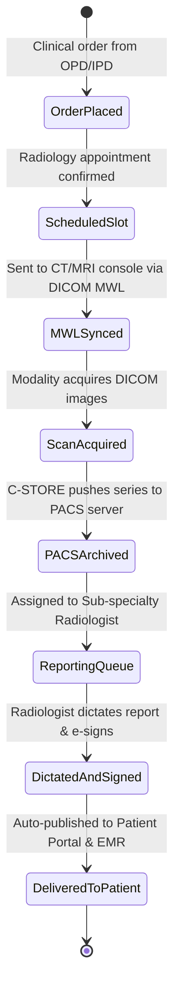

# 🏥 RADIOLOGY, DICOM / PACS VIEWER & VOICE DICTATION
**Covers Module #16 (Radiology / Imaging / PACS / DICOM)**

---

## 1. RADIOLOGY WORKFLOW & PACS ARCHITECTURE (Module #16)

### 1.1 Clinical Workflow
Modality Integration (DICOM C-STORE, C-FIND, C-MOVE, Modality Worklist MWL):
1. **Order Creation**: Doctor orders MRI Brain or Chest X-Ray in EMR $\implies$ Order arrives in Radiology Information System (RIS).
2. **Modality Worklist (MWL)**: CT / MRI / X-Ray machine pulls patient details (UHID, Name, Accession Number, Exam protocol) over DICOM TCP port 104.
3. **Scan Execution & C-STORE**: Radiographer performs scan $\implies$ Modality pushes DICOM slices to central Findmedi PACS server (dcm4chee or Orthanc backend / S3 Glacier cold storage).
4. **Radiologist Reading**: Radiologist opens Web-based Zero-Footprint DICOM Viewer $\implies$ Window Level (WL/WW), Multi-Planar Reconstruction (MPR), 3D Volume Rendering, Cobb Angle, and Length calibration.
5. **Voice Dictation & Structured Reporting**: Radiologist speaks findings $\implies$ Web Speech API / Whisper transcription converts voice to formatted radiology report $\implies$ Pathologist / Radiologist digital e-signature attached.

### 1.2 State Machine


### 1.3 Web DICOM Viewer Tech Stack & Frameworks
- **Framework**: React 18 / TypeScript
- **DICOM Rendering Engine**: `@cornerstonejs/core` and `@cornerstonejs/tools` (WebGL2 / WebGPU hardware-accelerated 3D rendering).
- **Image Parsing**: `cornerstone-wado-image-loader` and `dicom-parser`.
- **UI Components**:
  - `CornerstoneViewport.tsx`: Canvas container with windowing presets (Lung, Bone, Brain, Soft Tissue).
  - Measurement Tools: Length, Angle, Elliptical ROI (mean Hounsfield Units - HU), Bidirectional ruler.
  - Cine Loop player: Smooth scroll through 500+ CT axial slices with FPS control slider.
- **Micro-Animations**:
  - Smooth pan/zoom transitions with CSS transforms.
  - Sound wave visualizer animation for active microphone voice dictation.

### 1.4 Database Schema (PostgreSQL)
```sql
CREATE TABLE radiology_studies (
    id UUID PRIMARY KEY DEFAULT gen_random_uuid(),
    hospital_id UUID NOT NULL,
    uhid VARCHAR(50) NOT NULL,
    accession_number VARCHAR(100) UNIQUE NOT NULL,
    modality VARCHAR(20) NOT NULL, -- CT, MRI, XR, US, MG, NM
    study_instance_uid VARCHAR(128) UNIQUE NOT NULL,
    study_description VARCHAR(255) NOT NULL,
    body_part_examined VARCHAR(100) NOT NULL,
    ordered_by_doctor_id UUID NOT NULL,
    referring_clinical_notes TEXT,
    study_timestamp TIMESTAMP WITH TIME ZONE NOT NULL,
    number_of_series INT DEFAULT 1,
    number_of_instances INT DEFAULT 1,
    pacs_storage_path TEXT NOT NULL, -- s3://findmedi-pacs/studies/...
    assigned_radiologist_id UUID,
    status VARCHAR(30) DEFAULT 'ACQUIRED' -- ORDERED, SCHEDULED, ACQUIRED, REPORTING_IN_PROGRESS, REPORT_VERIFIED
);

CREATE TABLE radiology_reports (
    id UUID PRIMARY KEY DEFAULT gen_random_uuid(),
    study_id UUID REFERENCES radiology_studies(id),
    radiologist_id UUID NOT NULL,
    clinical_history TEXT,
    technique_protocol TEXT,
    findings_narrative TEXT NOT NULL,
    impression_summary TEXT NOT NULL,
    birads_or_pirads_score VARCHAR(50),
    critical_findings_alert BOOLEAN DEFAULT FALSE,
    critical_findings_communicated_to VARCHAR(150),
    digital_signature_hash TEXT NOT NULL,
    verified_at TIMESTAMP WITH TIME ZONE DEFAULT NOW()
);
```

---
*Created as part of the Findmedi Enterprise HMS Comprehensive Blueprint.*
