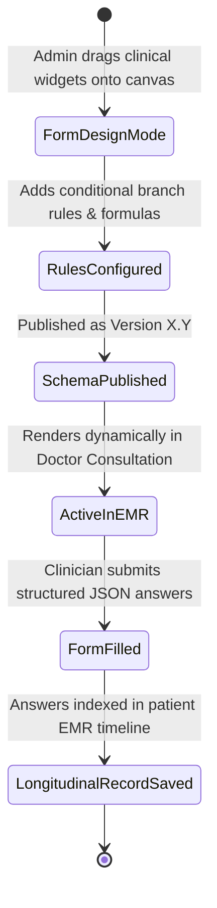

# 🏥 CUSTOM FORM BUILDER & TEMPLATE STUDIO SPECIFICATION
**Covers Modules #97 (Document / Template Builder) and #98 (Custom Drag-and-Drop Form Builder)**

---

## 1. DYNAMIC DRAG-AND-DROP CLINICAL FORM BUILDER (Module #98)

### 1.1 Technical Logic & Problem Statement
Hospital departments (Cardiology, Paediatrics, Oncology, Gynaecology, Dental, Mental Health) require bespoke specialized clinical forms without demanding continuous developer code commits. 
The Form Builder provides a visual WYSIWYG canvas enabling Clinical Administrators to compose complex JSON-Schema driven forms with:
1. **Field Types**: Text, Number, Date/Time, Select Dropdown, Radio, Checkbox, Slider, Body Map Diagram annotation, Canvas Signature, File Upload, Repeating Dynamic Tables, and Computed Formulas (e.g., BMI = Weight / Height²).
2. **Conditional Logic Rules**: E.g., `IF Gender == 'Female' AND Age > 12 -> Show 'Menstrual History' Section`.
3. **Validation & Medical Ranges**: Hard stops on out-of-range clinical inputs (e.g., Heart Rate $< 20$ or $> 300\text{ bpm}$).

### 1.2 State Machine


### 1.3 Frontend Tech Stack & Architecture
- **Framework**: React 18 / TypeScript
- **DnD Engine**: `@dnd-kit/core` and `@dnd-kit/sortable` (smooth accessible 60 FPS drag-and-drop).
- **Form State**: `react-hook-form` + `zod` for real-time schema validation.
- **Components**:
  - `FormCanvasBuilder.tsx`: Left toolbox sidebar, Center draggable canvas, Right properties inspector.
  - `FormRenderer.tsx`: Dynamic interpreter engine converting stored JSON schema into native form fields with real-time conditional evaluation.
- **Micro-Animations**:
  - Floating drag shadows (`box-shadow: 0 20px 25px -5px rgb(0 0 0 / 0.1)`).
  - Smooth expansion collapse when conditional fields show/hide (`framer-motion` `<AnimatePresence>`).

### 1.4 Database Schema (PostgreSQL)
```sql
CREATE TABLE dynamic_form_schemas (
    id UUID PRIMARY KEY DEFAULT gen_random_uuid(),
    hospital_id UUID NOT NULL,
    form_code VARCHAR(100) UNIQUE NOT NULL, -- e.g. FORM-CARDIO-ECHO-V1
    form_title VARCHAR(200) NOT NULL,
    department VARCHAR(100) NOT NULL,
    version INT DEFAULT 1,
    schema_definition JSONB NOT NULL, -- Array of widgets, labels, validation rules
    conditional_rules JSONB, -- Logic graph
    is_published BOOLEAN DEFAULT FALSE,
    created_by UUID NOT NULL,
    created_at TIMESTAMP WITH TIME ZONE DEFAULT NOW()
);

CREATE TABLE dynamic_form_responses (
    id UUID PRIMARY KEY DEFAULT gen_random_uuid(),
    schema_id UUID REFERENCES dynamic_form_schemas(id),
    uhid VARCHAR(50) NOT NULL,
    encounter_id UUID NOT NULL,
    filled_by_doctor_id UUID NOT NULL,
    response_payload JSONB NOT NULL, -- {"bp_systolic": 130, "echo_ef_percentage": 55, "notes": "Normal"}
    submitted_at TIMESTAMP WITH TIME ZONE DEFAULT NOW()
);
```

---

## 2. DOCUMENT & PRINT TEMPLATE STUDIO (Module #97)

### 2.1 Operational Logic & Variable Substitution Engine
Hospitals require branded print layouts for Prescription Slips, Discharge Summaries, Lab Reports, Invoices, and Medical Certificates:
1. **Dynamic Tag Interpolation**:
   Supports variables like `{{patient_name}}`, `{{uhid}}`, `{{doctor_name}}`, `{{diagnosis}}`, `{{rx_table}}`, `{{hospital_logo_base64}}`, `{{barcode_svg}}`, `{{qr_verification_url}}`.
2. **Page Header / Letterhead Switching**:
   Option to print with full color hospital letterhead, OR print in "Pre-printed Stationary Mode" (suppresses header/footer graphics and only prints text within exact millimeter margins).
3. **Esc/POS Thermal Print Mode**:
   Direct RAW ESC/POS generation for $80\text{mm}$ and $58\text{mm}$ thermal receipt printers for fast OPD tokens and pharmacy bills.

### 2.2 Database Schema (PostgreSQL)
```sql
CREATE TABLE print_document_templates (
    id UUID PRIMARY KEY DEFAULT gen_random_uuid(),
    hospital_id UUID NOT NULL,
    template_type VARCHAR(50) NOT NULL, -- PRESCRIPTION, DISCHARGE_SUMMARY, LAB_REPORT, BILL_INVOICE, WRISTBAND
    template_name VARCHAR(150) NOT NULL,
    page_size VARCHAR(20) DEFAULT 'A4', -- A4, A5, THERMAL_80MM, THERMAL_58MM, WRISTBAND
    margin_top_mm INT DEFAULT 20,
    margin_bottom_mm INT DEFAULT 20,
    margin_left_mm INT DEFAULT 15,
    margin_right_mm INT DEFAULT 15,
    html_content TEXT NOT NULL,
    header_html TEXT,
    footer_html TEXT,
    styles_css TEXT,
    is_default BOOLEAN DEFAULT TRUE,
    updated_at TIMESTAMP WITH TIME ZONE DEFAULT NOW()
);
```

---
*Created as part of the Findmedi Enterprise HMS Comprehensive Blueprint.*
